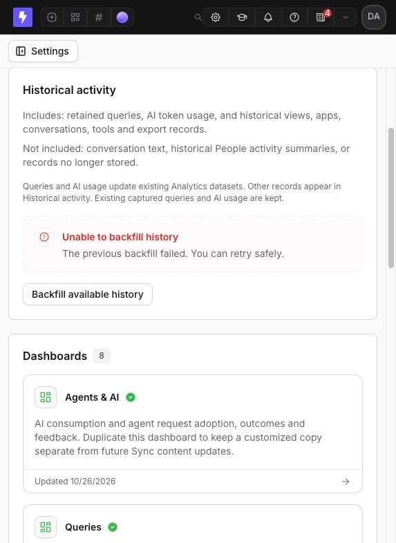
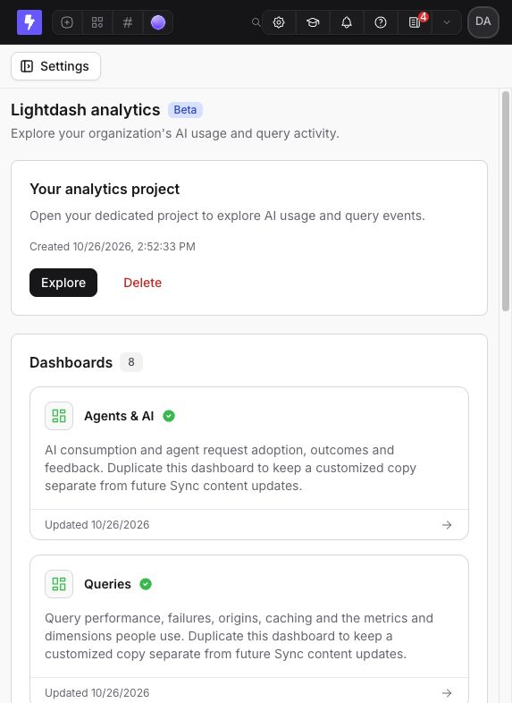
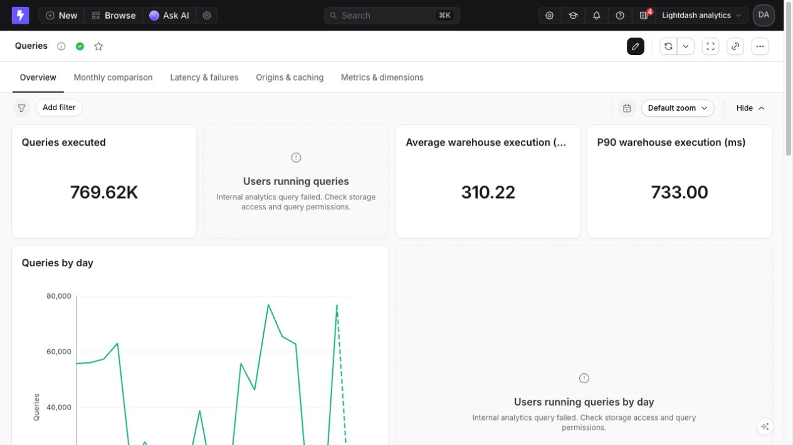
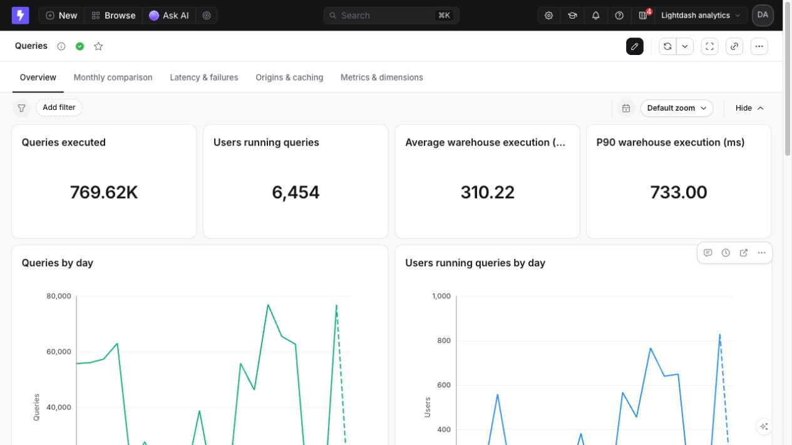

# Simplified backfill — live recheck, 27 October 2026

The simplified implementation uses its own low-priority serial queue, imports only published-event gaps, and does not write dimension snapshots. Status contains only running/completed/error.

- Actual normal compaction completed while one backfill was active; a second backfill remained queued. Maximum observed active backfills: one. All seven existing dimension objects retained their ETags and modification times.
- New-project creation returned while its automatic backfill was active, followed by successful completion. A deliberately held QA source-table lock made an earlier backfill fail; it remained retryable and was recovered through the Settings button.
- Settings showed the failed job, disabled its action during retry, hid the card after completion and kept it hidden after reload. The running state was observed live; the captured screenshots show retry and completed states.
- A no-op rerun preserved all 13 existing data-object SHA256 hashes. Live query results contained 28 distinct query identities and four distinct AI event identities. Late captured values took precedence over imported values.
- 142 focused tests passed (115 backend, 14 frontend, 13 warehouse). Backend/frontend typechecks, changed-file lint, formatting, unused exports and diff checks passed.
- Local isolated QA fixtures only. These are functional checks, not a production throughput benchmark. One shared worker slot is still used.

See `simplified-queue-evidence.json` and `simplified-overlap-evidence.json` for the measured queue and overlap checks.

---

## Earlier evidence (preceding implementations)

# PROD-12592 live QA

Isolated local Lightdash instance, 26 October 2026. Synthetic fixtures only.

## Combined history backfill

- 13: Existing project before backfill: 26 missing, 8 existing, 11 pending records across queries, AI usage and historical activity.
- 14: After the single action: 0 missing, 34 existing, 11 pending; the Settings card disappears.
- 15–16: Historical activity is immediately queryable: 24 records, including AI/tool/app facts, legacy views, download requests and export jobs.
- 17: AI usage after importing retained records and receiving a late native event: 3 distinct calls, 1,524 tokens. Captured event replaces the imported copy.

Sequential and concurrent reruns preserved AI/history object bytes. Changing one retained app-version snapshot produced exactly one missing record; rerun updated it without increasing the 24-row total. Cross-organization fixtures were excluded and private payload sentinel values were absent.

Fresh third organization: creating Analytics automatically ran compaction and the combined backfill on the same queue. Coverage reached 0 missing / 3 existing in 8.31 seconds; query, AI usage and app history were immediately queryable without manual backfill or nightly processing.

Screenshots 04–12 are earlier query-specific QA, retained for the failure/retry and existing-project history checks. The implementation now imports all supported sources through one operation; see docs/usage-analytics/history-backfill.md in the PR for the source inventory and limitations.

## 27 October: lightweight Settings status

Screenshots18–19 show the current simplified UI: no exact-count/date scan, one action while the current completion marker is absent, then hidden after successful backfill and a full page reload. Earlier screenshots are retained as historical test evidence; their live-count UI is superseded.

The status endpoint now checks job state and at most one org-scoped S3 HEAD. Five isolated API requests produced exactly five HEAD200s and zero LIST/GET/Parquet reads. Warm local responses took18–21ms; this is a local measurement, not a cloud benchmark. The expensive reconciliation runs only in the worker. A successful versioned marker does not imply continuous coverage of future database changes; direct reruns remain safe.

## Okteto distinct-user memory regression (27 October 2026)

Code commit: `704a28b8535c5407726a6b787d84891723e55085`. [Verified deploy](https://github.com/lightdash/lightdash/actions/runs/40500964878/job/122178457406).

The old reconciliation window reproduced an out-of-memory failure at ~770k rows under the existing 256 MB / four-thread / no-spill settings. The actual reader regression fails with the old implementation and passes after replacing the window with a filtered anti-join. All 14 focused warehouse tests, warehouse typecheck, changed-file lint/format and git secrets scan passed.

Live uncached queries and the dashboard both succeeded after redeploy: 6,454 distinct users; daily users across October 7–27. The source counts remain 769,265 captured queries (October 7–26) and 352 imported queries (October 27). The earlier backfill ran in 16.7 seconds; database replacement on preview deploy explains why its DB history is newer than its retained S3 data. The retained history remained queryable while the creation-triggered background job ran; its status subsequently returned completed. API timings include network and queue time and are not a throughput benchmark.

The underlying Okteto error was sanitized; the OOM was directly reproduced locally with the same query/resource limits, then the fix was verified live.

Before:

After:

Evidence: `memory-regression-summary.json`, `memory-fix-live.json`, `exact-backfill-date-summary.json`.
