# Spike: a funnel as a composer node

Status: spike, 2026-11-03. Read-only lineage cell first; editing later.

## Question

Can a conversion funnel be one of the node kinds the query composer runs,
declared like a metric query (no SQL written by the user), reusing the
funnel builder's SQL logic, and shown in the Lineage tab like any other cell?

## Answer

Yes, with three small pieces, none of which touch the engine:

1. **Model.** `FunnelSourceQuery` is a new member of the `SourceQuery` union
   (`packages/common/src/types/querySources.ts`), discriminated by
   `QuerySourceType.FUNNEL`. Its fields are the funnel builder's
   `FunnelQueryRequest` plus the node envelope (`nodeId`, `title`,
   `description`, `limit`): explore, the three event fields (who / when /
   what), ordered steps, date range, conversion window, optional breakdown.
   It reads no other node, so it is a **source node** in the Lineage.
2. **Backend.** `FunnelQuerySource` implements `QuerySourceClient`: it loads
   the explore, compiles the funnel with the SQL generator extracted from
   `FunnelService` (`services/FunnelService/funnelSql.ts`) and submits the
   compiled SQL through `executeAsyncSqlQuery`, exactly as `SqlQuerySource`
   does. Registered in `QuerySourceRegistry.withBuiltInSources` behind the
   existing `funnelBuilder.enabled` config (on in PR mode). The result
   columns are a fixed contract downstream DuckDB nodes can read:
   `step_order, step_name, total_users, conversion_rate,
   step_conversion_rate, median_time_to_convert[, breakdown_value]`.
3. **Frontend.** The Lineage cell renders `FunnelNodeDetails` where a
   semantic cell renders its metric-query details. Node icon, type label
   ("Funnel") and the explore toolbar come from the same switch sites every
   other kind uses (`nodeTypeIcon`, `nodeTypeLabelOf`, `NodeQuery`).

Everything else (statuses, row counts, results toggle, lineage lines,
"Add to chat") works unchanged because the node flows through the standard
async query pipeline.

## Cell information architecture

What a reader must get from the cell, in priority order:

1. **The steps, in order, and the rule between them.** Event A, then B, then
   C; a user counts in a step only after every earlier one; the next step
   must happen within the window. This is the funnel; it leads.
2. **Who, when, what.** The explore and the three fields the funnel reads:
   user id, timestamp, event name. Without them the steps are just words.
3. **Scope.** Date range scanned; breakdown dimension when set (and that a
   user converts only within the same breakdown value).
4. **What it returns.** One row per step (per breakdown value), with the
   fixed columns. Readers of the pipeline need this to follow the DuckDB
   node that reads the funnel.
5. **After a run:** users and conversion per step. Already available through
   the results toggle; a compact per-step strip is an option (variant C).

## Variants

All three render inside the real Lineage notebook (Storybook on a rainbow
env, light scheme, 700px cell). Baseline for comparison: a semantic cell.

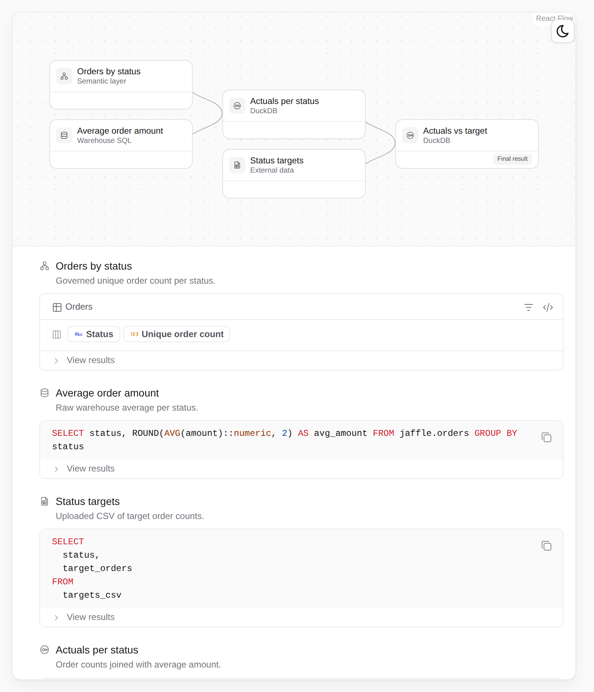

A pipeline with a funnel feeding a DuckDB node:

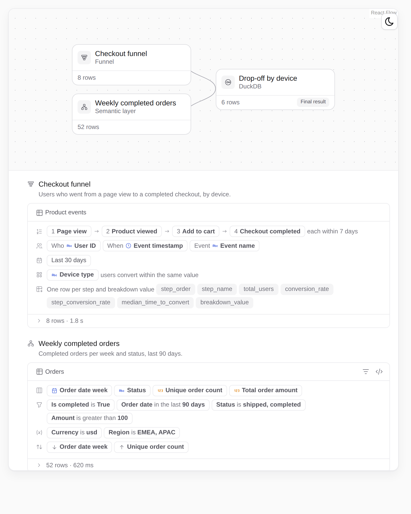

### A. Rows (default)

The semantic-cell idiom: icon-led rows for Steps, Source, Range, Breakdown,
Returns. Steps are numbered chips joined by arrows with the window stated
once at the end.

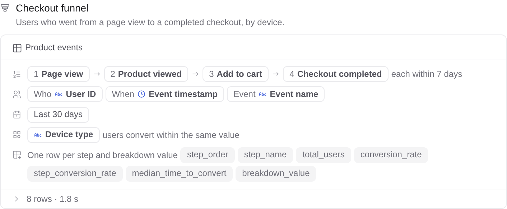

Minimal funnel (two steps, no breakdown, no window):

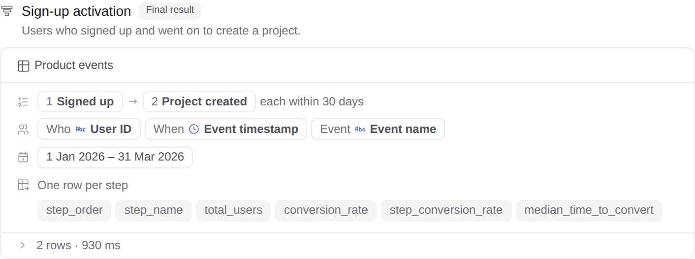

### B. Spine

Steps as a vertical numbered spine with "then, within 7 days" written between
each pair, so the rule between steps is read where it applies. Source fields,
range and breakdown form a footer chip line; returned columns stated below.

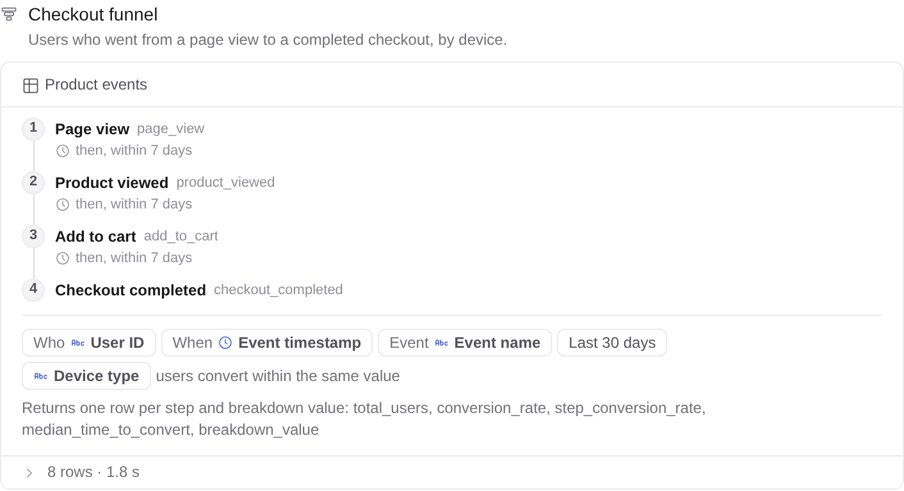

### C. Sentence

The funnel stated as one sentence with the moving parts emphasised, the three
event fields as chips beneath, and the returned shape as a short note.

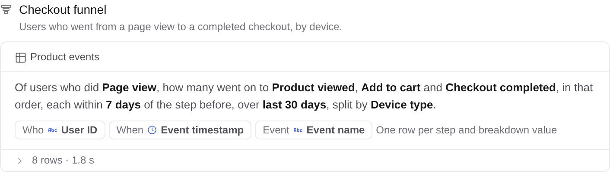

### Result strip (any variant)

After a run the results toggle opens a per-step strip instead of a raw table.
It follows the conventions every funnel tool shares (see "Reference
conventions"): a headline with total conversion (last step ÷ first) and the
largest drop, then one column per step with users, the share of step 1 as a
bar whose lighter remainder is the drop-off, that share as a number, and
"% of previous" beneath. Breakdown values are summed per step; the raw rows
stay available in the full results view. Median time to convert is not
aggregated across breakdown values, so the strip omits it.

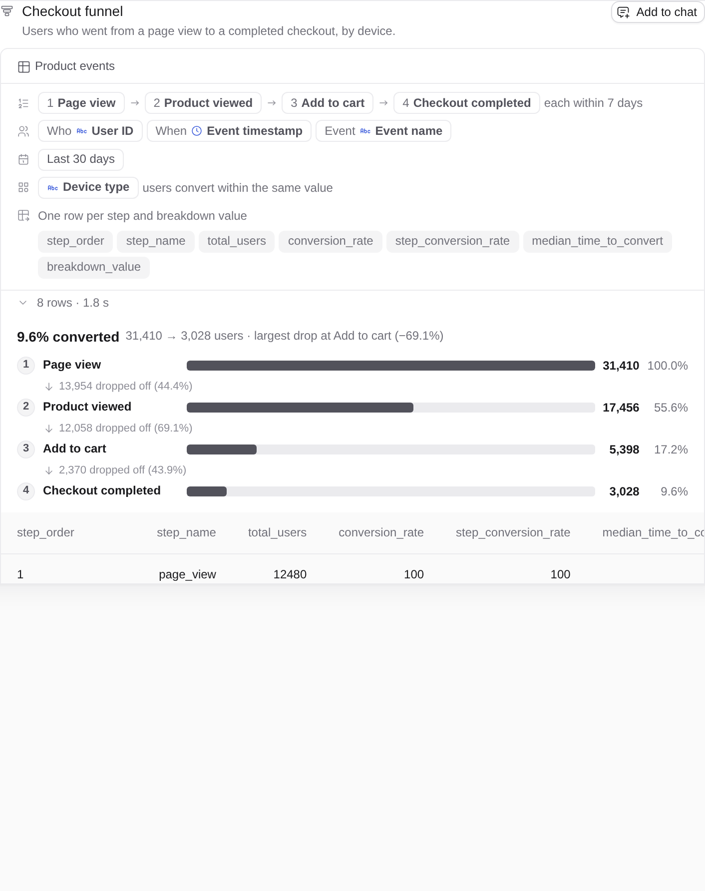

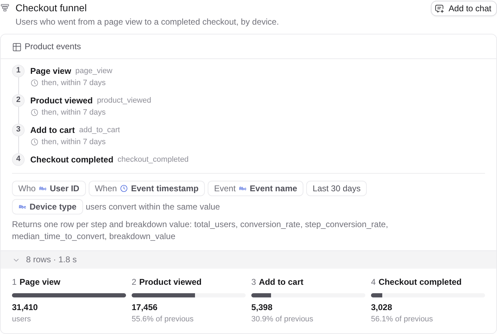

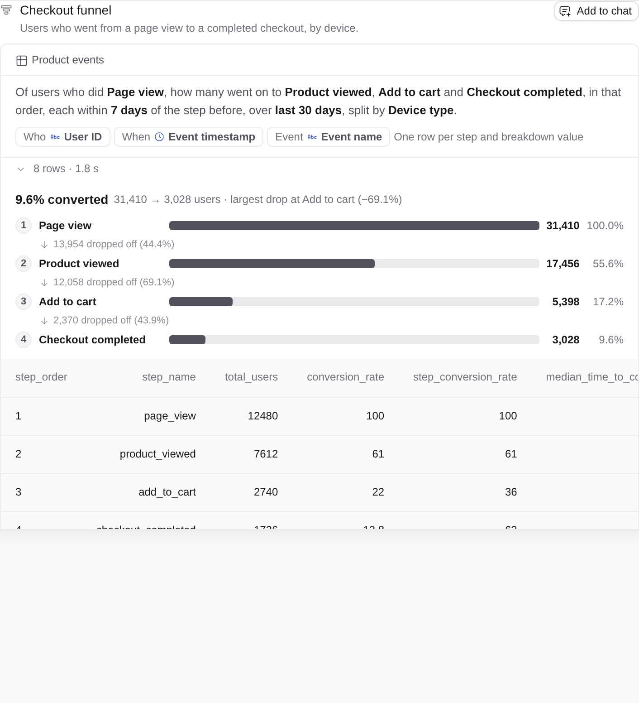

### Findings

- **A** is the safe default: zero new idiom, reads like every other cell,
  but the window ("each within 7 days") is easy to miss at the end of the
  steps row and the cell carries five rows of labels for one idea.
- **B** explains the mechanics best. Ordering, "then", and the window are
  read in the order the funnel applies them; the footer keeps the fields and
  scope scannable. Tallest of the three (one line per step plus one per gap).
- **C** is the fastest read and the shortest, and is the one a non-analyst
  would understand first. It is weakest for a pipeline reader who needs the
  returned columns, and it loses structure past ~5 steps.
- The result strip is the biggest single win: it turns the cell from "a
  query" into "a funnel" after a run and works under any variant.

Recommendation: ship **B (spine) plus the result strip** as the funnel cell.
Keep A's field-chip and row primitives (they are shared with the semantic
cell). Keep C's sentence as the cell's one-line summary candidate for the
collapsed/graph node tooltip rather than as the details body.

## Run through the agent

The agent can author a funnel node: the composer `query` tool offers a
`funnel` kind (`toolComposerQueryArgs.ts`) when `funnelBuilder.enabled` and
the agent has composer queries on. The pipeline refuses funnel nodes when the
kind is off, then checks the explore and the user, timestamp, event and
breakdown field ids exist on it. Funnel nodes need no SQL approval: the
server compiles them. `systemV2QueryingComposer` tells the agent to answer
"did A then B then C" and drop-off questions with a funnel node.

On a preview env with the Jaffle shop demo, "Show me the checkout funnel …
over the last 12 months, each step within 7 days, split by device type"
produced one funnel node (`steps: page_view → product_viewed → add_to_cart →
checkout_completed`, `last_12_months`, `7 days`, `device_type`), 12 rows,
and a correct reading of the drop-off:

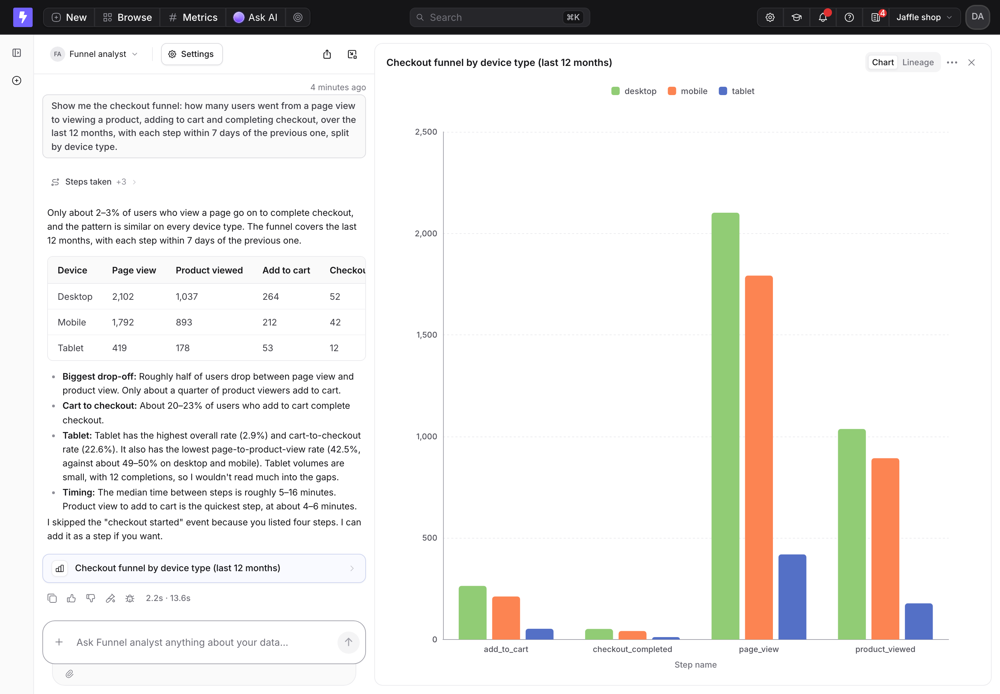

The Lineage tab of that run, with the funnel cell as the pipeline's only
node:

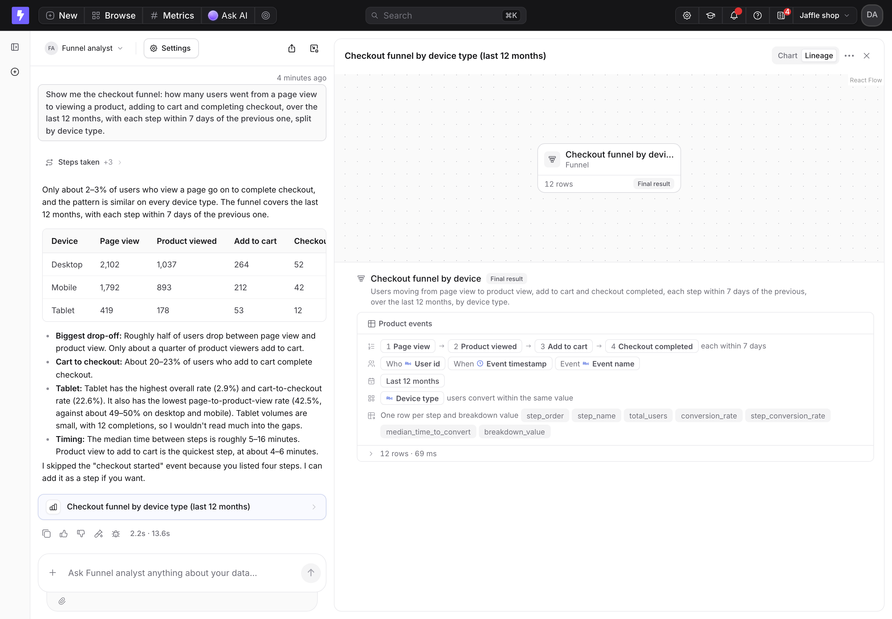

The cell with its results open:

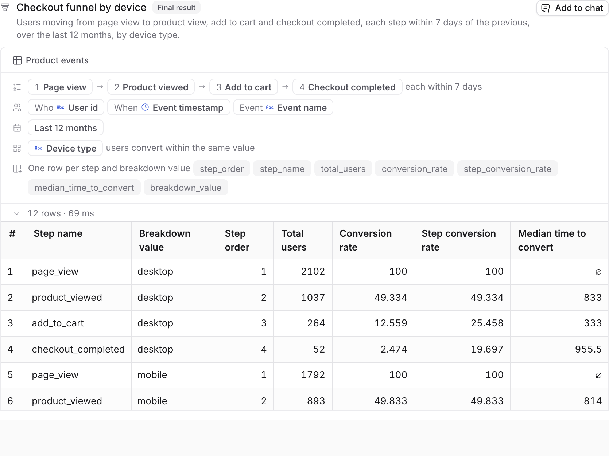

Seen in the run and fixed or noted:

- The agent charted the funnel as a grouped bar with steps sorted
  alphabetically. The node description now tells it to order the axis by
  `step_order`; a funnel-aware chart kind is the real fix.
- The results toggle showed the raw table only; `AiComposerNodeResult` now
  renders the result strip above the table for funnel nodes.

## Reference conventions

How Mixpanel, Amplitude, PostHog, Statsig, Kissmetrics and June present
funnels, so the cell reads as a funnel to anyone who has used one:

- Steps are an ordered, numbered vertical list; each step is an event name
  plus optional filter chips. Criteria read as one sentence under the steps:
  "uniques converting within 7 days in this order"
  (Mixpanel: https://docs.mixpanel.com/docs/reports/funnels/funnels-advanced,
  PostHog: https://posthog.com/docs/product-analytics/funnels).
- Order vocabulary is a 3-way: this order (default), exact order, any order.
  The funnel builder only supports "this order", so the cell states it once.
- Results are one column per step; drop-off is a lighter remainder in the
  same hue, never red (Amplitude:
  https://amplitude.com/docs/analytics/charts/funnel-analysis/funnel-analysis-interpret).
- Two percentages per step: overall (vs step 1) and relative (vs previous).
  One is the big number, the other secondary text; step 1 is always 100%
  (Statsig: https://docs.statsig.com/product-analytics/funnels, Kissmetrics:
  https://support.kissmetrics.io/docs/funnel-report-1).
- A headline of total conversion, often with "largest drop-off step" and
  "slowest step" (Amplitude's Takeaway strip).
- Breakdown renders as grouped bars per step plus a table with an "Overall"
  control row; steps still own the axis.

Taken into the cell: numbered steps with the window stated between or after
them (spine, rows), the one-sentence criteria (sentence), the headline and
two-percentage columns (strip). Not taken: colour per breakdown value and
the time-to-convert histogram, both of which belong to a chart over the
node's rows rather than to the cell.

## Out of scope, in order of value

1. **Agent write path.** A `funnel` node kind in the composer tool schema
   (`toolComposerQueryArgs.ts`) so the agent can author funnels; today only
   the public query-sources API can submit one. Small: a Zod shape mirroring
   `FunnelSourceQuery` plus a `toSourceQuery` case.
2. **Hand-built editor.** The funnel builder's sidebar already edits exactly
   these fields; it can become the cell's edit mode once the composer has
   per-node editing.
3. **Authorization.** The compiled SQL runs through the SQL runner path, so
   the node needs `manage:SqlRunner` like the funnel builder does today. A
   compiled, explore-bound query should eventually be gated like a metric
   query (view explore), which needs an AsyncQueryService entry for compiled
   SQL over an explore binding.
4. **Compiled SQL panel.** Semantic cells show their compiled SQL through
   `useCompiledSqlFromMetricQuery`; funnels have no compile endpoint yet.
5. **Funnel as a transformation.** The SQL generator assumes a base table.
   Running the same shape in DuckDB over a referenced node's rows (events
   from an API or Python node) would make funnels composable rather than
   only a source. Same cell, one more `references` field.
6. **Retire the `/funnel/*` REST endpoints** in favour of query sources once
   the builder page runs on a funnel node.
