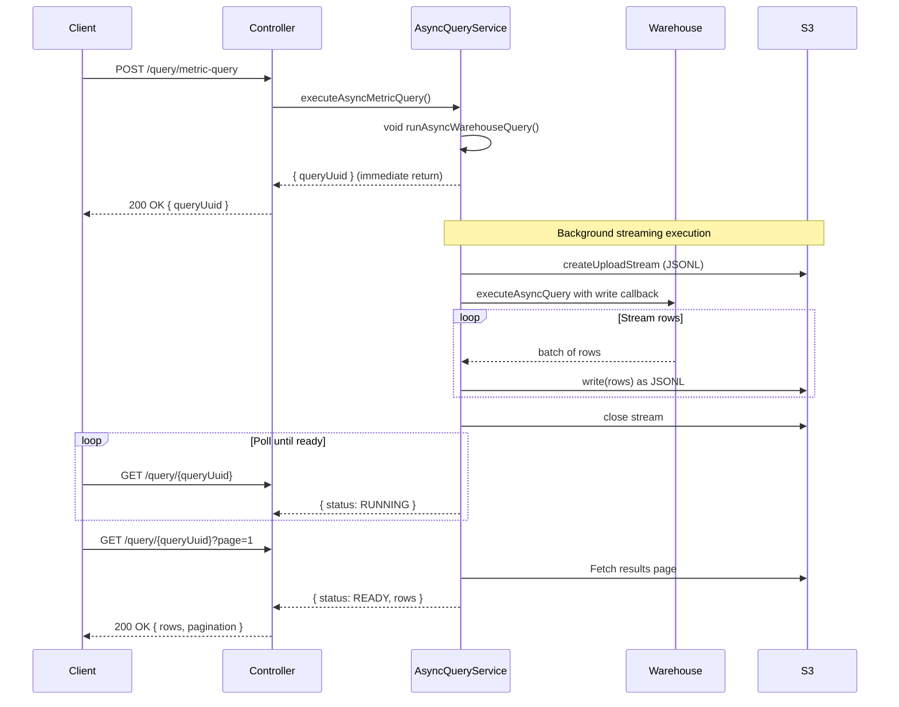

<summary>
AsyncQueryService handles asynchronous query execution against data warehouses. It uses a fire-and-forget pattern where execute methods start warehouse queries as void promises, return a `queryUuid` immediately, and clients poll for results. Results are streamed to S3 as JSONL during execution.

**Important**: While the API response is non-blocking (returns immediately), the actual query execution still runs on the main Node.js event loop and can block it during row processing for large result sets.

`runQueryAndTransformRows` is where pivot rows get spread into wide columns. For the full pivot pipeline, see `/docs/pivoting.md`.

</summary>

<howToUse>
The service follows a two-phase pattern:

1. **Execute**: Call an execute method to start the query. The warehouse query runs as a void promise (`void this.runAsyncWarehouseQuery(...)`), returning `queryUuid` immediately.
2. **Poll**: Call `getAsyncQueryResults` with the `queryUuid` to fetch paginated results.

The QueryController exposes these operations via REST endpoints at `/api/v2/projects/{projectUuid}/query/`.

**Prepare/execute seam.** Metric execution prepares a `QueryComposer`; SQL
runner, saved SQL chart, and dashboard SQL-chart execution prepare a
`SqlQueryComposer`. The prepared args carry that composer plus orchestration
data such as credentials and routing metadata. They do not duplicate explore,
query, fields, pivot, timezone, parameter, or access-control state.

`executePreparedAsyncQuery` reads those values through the composer getters,
and `getSql({ columnLimit })` is the only SQL-generation seam for both metric
and SQL-chart paths. Keep new query context on the composer and expose a getter
when execution needs it; do not add parallel loose fields to
`PreparedAsyncQueryArgs`. Construct composers directly at their preparation
sites rather than adding a service-level factory.

For metric queries, `totalConfiguration` is reserved for calculate-total
replays and is mutually exclusive with `dashboardFilters`.
`executeAsyncMetricQuery` rejects calls that set both before composer
preparation.
</howToUse>

<codeExample>

```typescript
// Phase 1: Execute a query (returns immediately, warehouse query runs in background)
const { queryUuid, cacheMetadata } =
    await asyncQueryService.executeAsyncMetricQuery({
        account: req.account,
        projectUuid: 'abc-123',
        metricQuery: {
            exploreName: 'orders',
            dimensions: ['order_date'],
            metrics: ['total_revenue'],
        },
        context: QueryExecutionContext.EXPLORE,
    });

// Phase 2: Poll for results using the queryUuid
const results = await asyncQueryService.getAsyncQueryResults({
    account: req.account,
    projectUuid: 'abc-123',
    queryUuid,
    page: 1,
    pageSize: 500,
});

// Check status - results may still be running
if (results.status === QueryHistoryStatus.READY) {
    console.log(results.rows); // Paginated data
}
```

</codeExample>



<importantToKnow>
**Fire-and-Forget Execution:**
The `executeAsyncQuery` method starts warehouse queries using `void this.runAsyncWarehouseQuery(...)`. Errors are caught internally and logged, not thrown to the caller.

**Composer ownership:**
`QueryComposer` owns metric compilation, totals collapse, and optional pivot SQL
wrapping. `SqlQueryComposer` owns virtual-view/user-SQL wrapping and inherits the
same pivot seam. Once preparation returns a composer, downstream execution must
read query context from it rather than recomputing or carrying a second copy.

**Streaming Results to S3:**
During execution, `runAsyncWarehouseQuery` creates an upload stream via `resultsStorageClient.createUploadStream()`. The warehouse client's `executeAsyncQuery` receives a `write` callback that streams rows as JSONL directly to S3 as they arrive from the warehouse.

**Event Loop Blocking (Known Issue):**
The streaming callback runs synchronously on the main thread. For each batch of rows:

1. For pivot queries: `rows.forEach()` loop does pivot transformations and Map operations
2. `write()` calls `JSON.stringify(row)` for every row (S3ResultsFileStorageClient:103)
3. `passThrough.push()` writes to the S3 stream synchronously

For queries returning millions of rows, this blocks the event loop during processing, affecting other requests on the same server instance.

**Execute Methods Available:**

- `executeAsyncMetricQuery` - Metric queries with dimensions/metrics
- `executeAsyncSavedChartQuery` - Saved chart execution
- `executeAsyncDashboardChartQuery` - Chart within dashboard context
- `executeAsyncUnderlyingDataQuery` - Drill-down into raw data
- `executeAsyncSqlQuery` - Raw SQL execution
- `executeAsyncSqlChartQuery` - Saved SQL chart
- `executeAsyncDashboardSqlChartQuery` - SQL chart in dashboard context

**Query Status Values:**
`PENDING`, `RUNNING`, `READY`, `ERROR`, or `CANCELLED`

**Polling Results Source:**
When `getAsyncQueryResults` is called, results are always read from the S3 JSONL file via `resultsStorageClient`. S3-compatible storage is required at boot (see `parseBaseS3Config`), so every warehouse uses this path uniformly — there is no warehouse re-query fallback.

**Pagination:**
Results are paginated (default 500 rows, max 5000). Use `page` and `pageSize` parameters.

**Results page workers and stored results pages (`results-page-workers` and `stored-results-pages` flags, both off by default):**
The paginated results route calls `getAsyncQueryResultsResponse`, not `getAsyncQueryResults`. Both run one shared flow (`loadAsyncQueryResultsPage`) with the same access checks, status handling, expiry check, pagination checks, analytics events and envelope. Every other caller (AI agent, MCP, scheduler) keeps `getAsyncQueryResults`, which never checks the flags or reads a stored page.

Both flags are organisation only (`ORGANIZATION_ONLY_FLAGS`): a user override has no effect. `getResultsPageMode` picks one path per READY page:

- `off`: `results-page-workers` is off. Today's inline path, not counted in metrics. `stored-results-pages` alone does nothing.
- `inline`: the page has fewer cells (rows on the page x result columns) than `LIGHTDASH_QUERY_RESULTS_PAGE_WORKER_MIN_CELLS` (default 5,000). Formatted on the main thread as today, with no worker and no store call. Inline formatting measured 18-37 µs per cell, so 5,000 cells is about 90-185 ms of main-thread time.
- `worker`: built in a worker with no store GET, HEAD or PUT. Used when `stored-results-pages` is off or the project's results cache is off (results files are unique per execution without it, so a stored page could never be read again).
- `stored`: both flags on, results cache on: built in a worker and stored, as below.

In the `worker` and `stored` modes a READY page comes back as the serialised response body:

- Build: the main thread reads the page's JSONL lines. A worker from `ResultsPageWorkerPool` (lazy, FIFO, `LIGHTDASH_QUERY_RESULTS_PAGE_WORKERS`, default 2, at most 8 queued builds per worker) parses, formats and stringifies them one row at a time. It returns the `rows` bytes and a brotli copy. The request answers at once, and in `stored` mode the brotli copy uploads in the background.
- Workers run with `resourceLimits.maxOldGenerationSizeMb` from `LIGHTDASH_QUERY_RESULTS_PAGE_WORKER_MAX_HEAP_MB` (default 1024). A worker that runs out of heap gives `ResultsPageWorkerError` and is replaced. A worker idle for 60 seconds is terminated and started again on the next build. Small deployments (1 vCPU or under 2GB of memory) should set `LIGHTDASH_QUERY_RESULTS_PAGE_WORKERS=1`.
- Hit (`stored` mode): one GET of the stored object, one HEAD of the results file at the same time, and one decompress job. No JSONL read, parse, format or stringify. If the results file is gone, the request gets `ResultsExpiredError`, as the inline path does, and the stored page is not served.
- Key: `<resultsFileName>.pages/<appVersion>/<formatHash>/<pageSize>/<page>.json.br`, next to the results file. `formatHash` covers `fields`, `pivotValuesColumns`, the display timezone, the host locale and timezone, and a hash of common's `utils/formatting.js` (the formatter revision). A results-cache hit has a new `queryUuid` on the same results file, so it reuses the stored pages.
- Stored pages hold the formatted rows of every field. Any per-reader field projection on this route (for example dropping fields an AI reader must not see) must bypass stored pages or be part of the key. Access checks run before any store read.
- `StoredResultsPages` keeps one build per key per process until its upload settles. The stored page GET and the results file HEAD each stop after 15s, and a timeout counts as a miss. The upload stops after 30s. Uploads in flight hold at most 256MB of rows and brotli bytes: past that, the page still answers and the upload is dropped. Stored page decompression holds at most 256MB of output at once; later hits wait. When every caller of a build has closed its request (the controller aborts `signal` on `res` close) and the build is still queued or reading storage, the build is dropped. A store read error or a corrupt object rebuilds the page. An upload error still answers.
- Busy: a full queue, the build time limit or a worker error rejects with `ResultsPageWorkerError`. The service turns it into `ResultsPageBusyError` (503, `data.retryAfterSeconds`), and the controller adds `Retry-After`. Every waiter of a failed shared build gets that one error; nothing rebuilds the page inline. The frontend's `shouldRetryQuery` retries `ResultsPageBusyError` up to 10 times, waiting at least `Retry-After` (capped at 8s).
- One build takes at most `RESULTS_PAGE_BUILD_TIMEOUT_MS` (2 minutes), from its place in the queue to the brotli copy. The pool passes the build signal to `getDownloadStream`, so the SDK request stops while it waits for headers too. At the limit the pool aborts the read signal (`readResultsPageLines` destroys the storage body with `destroyS3Body`), terminates the worker if it holds the job and frees the slot. A late result resolves and uploads nothing.
- Metrics: `lightdash_query_results_pages_total{source}` counts served pages (`inline`, `built` for the request that started a build, `shared` for requests that joined one, `stored`, `busy`) and `lightdash_query_results_page_duration_seconds` their time. `lightdash_query_results_page_builds_total{outcome}` counts distinct builds (`ok`, `error`, `dropped`). `lightdash_query_results_page_queue_wait_seconds`, `lightdash_query_results_page_queued_builds` and `lightdash_query_results_page_inflight_bytes{kind}` (upload, decompress) show outstanding work. Flag-off pages are not counted.
- `composeResultsPageBody` writes the body byte for byte as `res.json({ status: 'ok', results })` would. Build every new envelope field in `loadAsyncQueryResultsPage`, never in one path only.
- The worker entry (`resultsPages/resultsPageWorker.ts`) imports only `@lightdash/common`, so keep backend config, logger and Sentry out of it. It resolves next to the pool's own file: `.js` in `dist`, `.ts` under `tsx`, and `--import tsx` is added when the parent has no tsx loader (vitest).
</importantToKnow>

<links>
@packages/backend/src/controllers/v2/QueryController.ts - REST API endpoints
@packages/backend/src/services/AsyncQueryService/types.ts - Type definitions for all execute args
@packages/backend/src/utils/QueryBuilder/QueryComposer.ts - Metric-query preparation and SQL facade
@packages/backend/src/utils/QueryBuilder/SqlQueryComposer.ts - SQL-chart preparation and SQL facade
@packages/backend/src/models/QueryHistoryModel/QueryHistoryModel.ts - Query state persistence
@packages/backend/src/clients/ResultsFileStorageClients/S3ResultsFileStorageClient.ts - S3 streaming client
</links>
